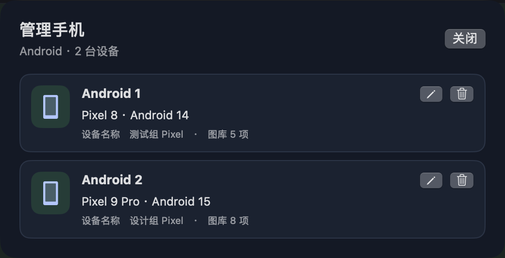

# 即图 · SnapRelay

把手机与 Mac 配对成功后新截取的截图自动传到同一局域网里的 Mac，也可以手动选择历史截图、照片和视频。Mac 接收时保留上传的文件字节。

## 使用方式

1. 打开 Mac 上的「即图」（SnapRelay），保持应用运行。关闭窗口后，仍可从菜单栏打开接收端。
2. 让手机和 Mac 连到同一局域网。点 Mac 窗口右上角的「扫码配对」，再用手机端的「扫一扫配对」扫描二维码。要换电脑，点手机端的「扫码更换 Mac」并扫另一台 Mac 的码，验证成功后手机会切换到新 Mac。取消扫码或验证失败时，原配对会保留。也可选择「手动配对」查看地址和配对码并在手机上输入。iOS 需要授权访问本地网络。
3. 授予完整相册权限后，App 可自动发现起点之后截取并保存到相册的新截图。短暂断网、重开手机 App 或更新同一配对的地址会沿用起点。断开后重新配对或改用新配对码时，验证成功会建立新的起点。
4. 从手动发送入口用系统相册多选照片和视频，确认目标 Mac 和数量后发送。MP4、MOV 和 M4V 视频可以手动发送，单文件上限 512 MiB。手动发送使用系统为本次选择授予的访问权限，自动同步暂停时也可使用。
5. 暂停自动同步可中断正在进行的自动传输。继续后，App 会检查配对起点之后尚未发送的截图。Mac 已收的图片会保留，重试时会按传输 ID 去重。
6. Mac 画廊按 iOS、Android、鸿蒙分类，支持预览图片和播放视频。用两侧按钮或 `←` / `→` 浏览同一筛选下的文件，`⌘C` 可复制当前图片。在访达删除文件后，点击「刷新」或按 `⌘R` 可清除旧预览。文件默认保存到 `~/Pictures/截图同步`。点工具栏的「清除全部图片…」可查看当前传图文件夹的路径和图片总数，确认后会把该文件夹顶层的图片移到 Mac 废纸篓，并刷新图库。
7. 在 Mac 的「管理手机」中可查看每部手机的名称、型号、系统版本，以及它在当前图库中的文件数。新登记的 Android 手机默认显示为 `Android 1`、`Android 2`，鸿蒙手机为 `Harmony 1`、`Harmony 2`。用铅笔可以改名，手机上报的型号和系统设备名显示在详情中。删除手机后，原有图片和视频可在「未识别设备」中查看。该手机再次成功发送新文件后会重新登记。

## 和配对设备对话

在 Mac 上选择具体手机的子标签，展开图库上方的对话栏，例如「与 iPhone 1 对话」。在手机上，展开已配对 Mac 下方的对话。收起后仍可看到最近一条消息和未读数量。每部手机有自己的记录，自定义设备名称后仍使用同一个对话。

可以输入或粘贴文字、复制收到的内容，也可以多选文件后点「发送」。在另一端点附件即可接收或保存。单条文字最多 64 KiB，每个附件最多 128 MiB。Mac 会在本机保存已发送的消息和附件，手机下次连上这台 Mac 并打开即图时可以取回。对话可在自动截图同步暂停时使用。

在手机对话里点「清除对话记录…」，可清除这部手机上当前对话的历史。勾选「同时删除已下载文件」可一并清理该对话里由即图登记并有权限删除的文件。通过分享另存的副本可在系统文件管理器中清理。

## 在 Mac 上截图

打开「本机截图」并点「开始截图」，或在即图运行时按 `⌃⌥S`（Control + Option + S）。拖选屏幕区域，按空格切换到窗口截取，按 Esc 取消。「本机截图」里的「截图设置」可以更改或停用全局快捷键，Mac 菜单栏也有截图入口。首次使用需在「系统设置」的「隐私与安全性」中允许即图录制屏幕。[Apple 屏幕录制权限说明](https://support.apple.com/zh-cn/guide/mac-help/mchld6aa7d23/mac)

截图完成后会打开编辑器，可裁剪、添加箭头、矩形、文字或画笔标注，并撤销或重做操作。按 `⌘C` 复制结果，按 `⌘S` 将 PNG 保存到当前图库的「本机截图」中。

从旧版升级时，现有配对会在新版首次成功验证 Mac 后建立同步起点。此前截取的图片可通过「手动选图」发送。

首版面向可信的家庭或办公局域网，通过带配对码的明文 HTTP 传输。配对码和截图内容在传输过程中可被监听。手机将截图发送到当前配对的 Mac，应用无需账号或云端中转。

## 工程

| 平台 | 工程 | 构建与运行 |
| --- | --- | --- |
| macOS 13+ | [macOS](macOS) | 安装 Swift 6 工具链，执行 `./macOS/build-app.sh`。双击 `macOS/dist/即图.app`。脚本默认按构建机器的架构生成本机临时签名包。 |
| iOS 17+ | [ios/ShotSync.xcodeproj](ios/ShotSync.xcodeproj) | 用 Xcode 打开项目，选择模拟器。安装到真机需要开发团队签名和设备配对。 |
| Android 10+ | [android](android) | 在 Android Studio 打开项目，或使用 JDK 17 和 Android SDK 36，在 `android` 目录运行 `./gradlew assembleDebug`。 |
| HarmonyOS NEXT（API 23+） | [harmonyos](harmonyos) | 将工程放在纯 ASCII 路径下，用 DevEco Studio 配置 SDK 和签名。自动读图库需要有 `ohos.permission.READ_IMAGEVIDEO` 的签名 Profile。[构建和授权步骤](harmonyos/README.md) |

## 自动同步的实际表现

- **iOS 27 及以上** 支持在使用其他 App 时照常按键截屏。先给即图完整照片和本地网络权限，完成 Mac 配对，并开启自动同步。在即图首页点「设置后台截屏同步」→「新建快捷指令」，添加「同步新截图到 Mac」操作，在编辑器的「自动化」中选「截屏」→ 存储到「照片」，并在本机启用。之后每当截屏存入照片，系统都可以在后台调用即图发送到当前配对的 Mac。换 Mac 后沿用同一条快捷指令。实际到达时间取决于系统触发、相册写入和局域网状况。[Apple 的截屏自动化说明](https://support.apple.com/zh-cn/149045)
- **iOS 17–26，或未启用截屏自动化时**，即图在前台收到截屏和相册变化事件时会检查新截图。切到后台后，已开始的传输可申请有限时间收尾，新的截图由系统择机补传，返回即图也会立即检查。[系统截屏通知](https://developer.apple.com/documentation/uikit/uiapplication/userdidtakescreenshotnotification) · [延长后台执行时间](https://developer.apple.com/documentation/uikit/extending-your-app-s-background-execution-time)
- **Android** 配对并授予完整相册权限后，点「开启后台实时同步」。前台服务会显示同步通知，切到其他 App 后也会监听媒体库。可在即图或通知中关闭，关闭后由 WorkManager 继续调度补传。截图通过拍摄时间及常见截图目录和文件名识别。[前台服务](https://developer.android.com/develop/background-work/services/foreground-services) · [WorkManager 调度](https://developer.android.com/develop/background-work/background-tasks/persistent/getting-started/define-work)
- **HarmonyOS NEXT** 按系统公布的路径读取截图相册，相册变动或回到即图时立即检查，优先发送最新截图。已准备发送的截图可申请短时后台运行，应用挂起后由 Work Scheduler 择机补传。受限图库权限需要华为签名授权。[相册路径](https://developer.huawei.com/consumer/en/doc/harmonyos-references/arkts-apis-photoaccesshelper-e/) · [短时任务](https://developer.huawei.com/consumer/en/doc/harmonyos-guides-V13/transient-task-V13/) · [后台延迟任务](https://developer.huawei.com/consumer/en/doc/HarmonyOS-Guides/work-scheduler/) · [受限权限](https://developer.huawei.com/consumer/en/doc/harmonyos-guides/restricted-permissions/)

要在同一网络接收截图，Mac 必须保持唤醒、接收端保持运行。若使用访客 Wi‑Fi 或开启了局域网设备隔离，手机和 Mac 可能无法互访。

## 验证状态

- **Mac** 已从运行中的 App 窗口识别配对二维码，并用码内信息完成接收端认证。隔离接收端验证了三平台来源归类、手动照片和自动截图的原始字节保留，以及重复请求去重。
- **iOS** 已编译模拟器和真机版本。模拟器验证了扫码配对数据、换 Mac 和失败回退。隔离测试调用实际快捷指令操作，验证了截屏延迟入库后的上传、重复触发去重、暂停和恢复。iOS 27 系统截屏触发到 Mac 收图的实际耗时需在配置自动化的真机上测量。
- **Android** 已生成调试 APK。Android 15 模拟器通过相机画面扫描了 Mac 生成的二维码，验证了换 Mac 后保留暂停设置，以及验证失败时保留原配对。也验证了切出 App 后触发系统截屏并发送原图、暂停恢复、去重及从通知栏关闭后台实时同步。Android 10–12 的选图兼容路径和不同设备的后台表现仍需设备验证。
- **HarmonyOS NEXT** 已用 OpenHarmony API 23 工具链做静态检查。使用系统接口的测试替身验证了二维码数据解析、换 Mac、图库事件、切到后台的短时续传、暂停和超时。构建 HAP 和真机摄像头验证需要华为 HarmonyOS SDK、签名 Profile 和鸿蒙设备。

## 局域网接口

Mac 默认使用 TCP 端口 `43871`。手机可用 `GET /v1/health` 检查连接并附加 `Authorization: Bearer <配对码>` 校验配对码。

配对二维码以 UTF-8 JSON 编码。字段 `type` 为 `snaprelay-pair`，`version` 为数字 `1`，`addresses` 包含 1–16 个形如 `http://192.168.1.2:43871` 的局域网 IPv4 地址，`token` 为 Mac 当前的 24 位十六进制配对码。手机用码中的配对码验证候选地址，收到 HTTP 200 和 `{"status":"ok"}` 后保存一个可用地址。在 Mac 的「手动配对」中重新生成配对码后，旧二维码随之失效。

配对保存后，新版手机端通过 `POST /v1/devices` 登记设备。请求体为空，携带配对认证、安装标识 `X-Device-ID`、平台 `X-Device-Platform` 和资料 `X-Device-Info`。资料里的字段按手机实际可读情况提供。Mac 上修改的名称独立保存，同名或同型号的两台手机按安装标识区分。

手机上传时发送 `POST /v1/screenshots`，使用原始媒体文件字节作为请求体。包含以下请求头。

| 请求头 | 用途 |
| --- | --- |
| `Authorization` | `Bearer <配对码>` |
| `X-Screenshot-ID` | 每张截图的稳定标识，1–256 个可见 ASCII 字符 |
| `X-Device-ID` | 可选。手机 App 安装级标识，32 位小写十六进制字符，用于区分同一平台下的多部手机 |
| `X-Device-Platform` | 可选。资料来源，取值为 `ios`、`android` 或 `harmony` |
| `X-Device-Info` | 可选。标准 Base64 编码的 UTF-8 JSON 对象，支持字符串字段 `name`、`model`、`osVersion` |
| `Content-Type` | `image/*` 或支持的视频 MIME 类型 `video/mp4`、`video/quicktime`、`video/x-m4v` |
| `Content-Length` | 原始文件长度，图片上限 64 MiB，视频上限 512 MiB |
| `X-Filename` | 手机客户端可附带的文件名 |

首次保存返回 HTTP 201，同一 ID 已保存在当前目录时返回 HTTP 200。Mac 校验媒体内容后保存原始文件，用传输 ID 的散列作为文件名后缀。iOS、Android、鸿蒙客户端现有的 `ios-`、`android-`、`harmony-` ID 前缀用于记录来源。

设备对话使用同一接收端。请求携带配对码、设备的安装标识和平台，以及独立的 64 位小写十六进制对话密钥 `X-Chat-Key`。手机为这次配对生成并保存密钥，Mac 在首次访问该设备对话时登记。

| 路径 | 用途 |
| --- | --- |
| `GET /v1/chat/messages?after=<序号>` | 按序号读取当前设备的新消息，返回 `messages`、`hasMore` 和 `macName`。首次读取从 0 开始。 |
| `POST /v1/chat/text` | 发送 UTF-8 文字，请求头 `X-Message-ID` 为客户端生成的 UUID，重试沿用同一 ID。 |
| `POST /v1/chat/file` | 发送原始文件，附带 `X-Message-ID` 和 `X-File-Name`（UTF-8 文件名的 Base64 编码）。 |
| `GET /v1/chat/files/<消息 UUID>` | 获取当前对话中该附件的原始字节。 |
